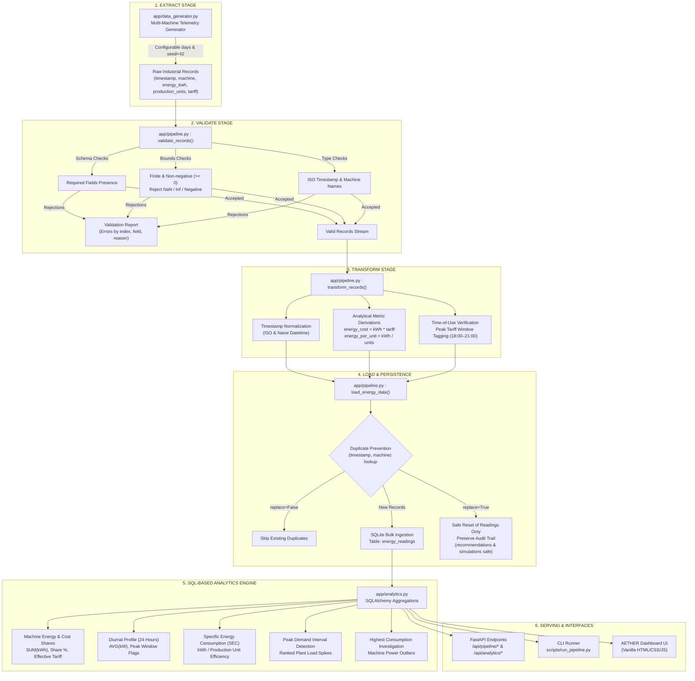
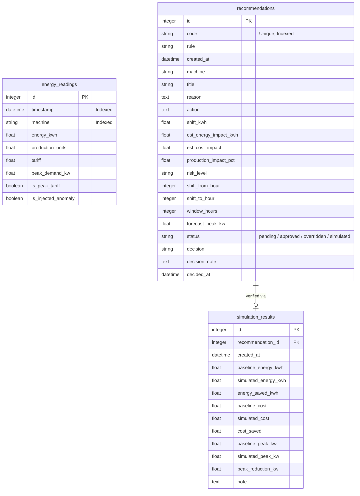

# AETHER — Data Pipeline Architecture & SQL Analytics Engine

## 1. Overview & Architecture

The **AETHER Data Pipeline** provides an industrial-grade, reproducible, modular ETL (Extract, Transform, Load) and SQL analytics engine for industrial energy telemetry. Built entirely on **Python, SQLite, SQLAlchemy, and FastAPI**, the system processes high-resolution machine readings, computes energy metrics, identifies peak demand spikes, and feeds downstream AI models (Linear Regression forecasting and Isolation Forest anomaly detection).



---

## 2. Pipeline Stages

### Stage 1: Extract
- **Module:** [`app.pipeline.extract_energy_data`](file:///c:/Users/Achuthanaathan%20S/OneDrive/Documents/AI-Energy-Management-System/app/pipeline.py)
- **Source:** Generated multi-machine telemetry simulating a 4-asset industrial facility:
  - `CNC-Mill-01` (Heavy cutting cycle, $25\text{ kW}$ baseline)
  - `Compressor-02` (Variable air compression, flexible shift candidate, $30\text{ kW}$ baseline)
  - `Chiller-03` (Industrial process refrigeration, flexible, $22\text{ kW}$ baseline)
  - `Conveyor-Line-04` (Continuous material transfer, $18\text{ kW}$ baseline)
- **Time-of-Use Tariffs:**
  - Off-Peak ($4.50\text{ /kWh}$, 22:00–05:59)
  - Standard ($7.00\text{ /kWh}$, 06:00–17:59)
  - Peak ($9.50\text{ /kWh}$, 18:00–21:59)
- **Parameters:** Configurable `days` (default: 30) and `seed` (default: 42). Using the default seed guarantees bit-exact reproducible datasets across test runs and demonstrations.

### Stage 2: Validate
- **Module:** [`app.pipeline.validate_reading`](file:///c:/Users/Achuthanaathan%20S/OneDrive/Documents/AI-Energy-Management-System/app/pipeline.py), [`app.pipeline.validate_records`](file:///c:/Users/Achuthanaathan%20S/OneDrive/Documents/AI-Energy-Management-System/app/pipeline.py)
- **Validation Rules:**
  1. **Schema Check:** All required keys (`timestamp`, `machine`, `energy_kwh`, `production_units`, `tariff`) must be present and not `None`.
  2. **Machine Name Check:** Non-empty string matching known assets.
  3. **Timestamp Integrity:** Must be a valid `datetime` instance or parseable ISO 8601 string.
  4. **Finite Number Check:** Rejects `NaN`, positive infinity (`+Inf`), negative infinity (`-Inf`), and non-numeric types (such as boolean values).
  5. **Non-negativity:** Values for `energy_kwh`, `production_units`, `tariff`, and `peak_demand_kw` must be $\ge 0.0$.
- **Validation Report:** Collects total counts and detailed itemized errors (row index, field, value, human-readable reason) without halting execution.

### Stage 3: Transform
- **Module:** [`app.pipeline.transform_reading`](file:///c:/Users/Achuthanaathan%20S/OneDrive/Documents/AI-Energy-Management-System/app/pipeline.py), [`app.pipeline.transform_records`](file:///c:/Users/Achuthanaathan%20S/OneDrive/Documents/AI-Energy-Management-System/app/pipeline.py)
- **Enrichments:**
  - **Timestamp Normalization:** Converts ISO strings to timezone-naive Python `datetime` objects for uniform indexing in SQLite.
  - **Peak Window Flagging:** Computes boolean `is_peak_tariff` against `PEAK_TARIFF_HOURS` $(18, 19, 20, 21)$.
  - **Derived Metric `energy_cost`:** $\text{energy\_kwh} \times \text{tariff}$.
  - **Derived Metric `energy_per_unit` (SEC):** $\text{energy\_kwh} / \text{production\_units}$ (safely sets $0.0$ if output units equal $0$).

### Stage 4: Load
- **Module:** [`app.pipeline.load_energy_data`](file:///c:/Users/Achuthanaathan%20S/OneDrive/Documents/AI-Energy-Management-System/app/pipeline.py)
- **Storage:** Local SQLite database (`energy.db`) via SQLAlchemy ORM.
- **Safeguards:**
  - **Duplicate Prevention (`replace=False`):** Queries existing `(timestamp, machine)` composite keys within the incoming batch window. Duplicates are counted and skipped, preventing accidental double-counting.
  - **Audit Trail Safeguard (`replace=True`):** When replacing the energy dataset, the loader deletes rows from `energy_readings` only. User decisions, operator notes, `recommendations`, and `simulation_results` remain intact.

---

## 3. SQL-Based Industrial Analytics

Located in [`app/analytics.py`](file:///c:/Users/Achuthanaathan%20S/OneDrive/Documents/AI-Energy-Management-System/app/analytics.py), the engine executes direct SQL aggregations on SQLite:

1. **Machine Energy Summary (`get_machine_energy_summary`):**
   ```sql
   SELECT machine, SUM(energy_kwh), AVG(energy_kwh), MIN(energy_kwh), MAX(energy_kwh), COUNT(id)
   FROM energy_readings
   GROUP BY machine ORDER BY SUM(energy_kwh) DESC;
   ```
2. **Machine Cost Summary (`get_machine_cost_summary`):**
   ```sql
   SELECT machine, SUM(energy_kwh * tariff) AS total_cost, SUM(energy_kwh) AS total_kwh
   FROM energy_readings
   GROUP BY machine ORDER BY total_cost DESC;
   ```
3. **Daily Aggregations (`get_daily_energy_consumption`):**
   ```sql
   SELECT DATE(timestamp) AS reading_date,
          SUM(energy_kwh) AS total_kwh,
          SUM(energy_kwh * tariff) AS total_cost,
          MAX(peak_demand_kw) AS peak_kw,
          SUM(production_units) AS total_units
   FROM energy_readings
   GROUP BY DATE(timestamp) ORDER BY reading_date ASC;
   ```
4. **24-Hour Diurnal Load Profile (`get_hourly_consumption_profile`):**
   Groups readings across the 30-day history into 24 bins (hours 0–23) to compute baseline load profiles and peak tariff impacts.
5. **Peak Demand Period Detection (`get_peak_demand_periods`):**
   Aggregates total facility demand by timestamp to surface the top load spikes:
   ```sql
   SELECT timestamp, SUM(energy_kwh) AS plant_kw, MAX(is_peak_tariff)
   FROM energy_readings
   GROUP BY timestamp ORDER BY plant_kw DESC LIMIT :limit;
   ```
6. **Specific Energy Consumption (`get_production_efficiency`):**
   Measures industrial production efficiency ($\text{SEC} = \text{Total kWh} / \text{Total Units}$) for each machine and benchmarks variance against facility average.
7. **Operator Investigation Spikes (`get_highest_consumption_readings`):**
   Surfaces top single-machine power outliers with injected anomaly flags and unit metrics.

---

## 4. Database Schema


